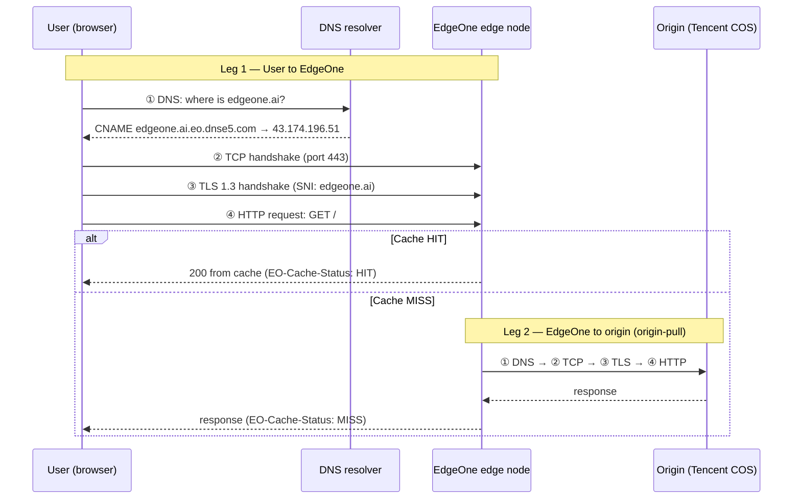

# W1 — End-to-End HTTPS Request, Layer by Layer

What happens when a user opens `https://edgeone.ai`, which stage each step belongs to, what can fail there, which EdgeOne status code that failure turns into, and how to check it.

All timings below are **real measurements** from my machine (Minnesota, macOS) using `eo_diag.py`, `curl`, `nslookup` and `ping`, 2026-10-01 to 10-08.

---

## 1. The big picture: two legs

A request through a CDN is really **two requests**:



- **Leg 1** fails → the user's browser shows a connection error (no status code at all).
- **Leg 2** fails → the user gets an **EdgeOne 52x** code, because the node is the one that failed to reach the origin.
- On a **cache HIT, Leg 2 never happens.** That is the core value of a CDN. In these tests the cached homepage (HIT) took ~80 ms and a missing page (MISS) ~1200 ms; origin round-trips likely contribute, but the two requests were for different resources, so the gap is not a clean measurement of origin cost.

---

## 2. The four stages

Both legs go through the same four stages, **in order**. A stage only starts if the previous one succeeded, so **the first failing stage is where to start looking** (the stage, not necessarily the root cause: a TCP timeout is often a firewall rule).

| # | Stage | What it does | Measured (Leg 1, edgeone.ai) | If it fails on Leg 2 → EdgeOne returns | How to check |
|---|---|---|---|---|---|
| ① | **DNS** | Turn a name into an IP | 4–160 ms typical; **3–6.5 s** outliers (see §4) | **523** | `dig`, `nslookup` |
| ② | **TCP** | 3-way handshake (SYN → SYN-ACK → ACK) | 33–52 ms | **521** refused (RST) · **522** no answer (5 s) | `nc -vz`, `Test-NetConnection` |
| ③ | **TLS** | Agree on encryption, verify certificate | 52–87 ms (TLS 1.3) | **525** | `openssl s_client` |
| ④ | **HTTP** | Send request, wait for response headers | 64–91 ms (HIT) · 1202–1282 ms (MISS) | **524** no answer (15 s) · **520** reset | `curl -I`, `curl -v` |

### What I saw at each stage

**① DNS**
```
$ nslookup edgeone.ai
Name:    edgeone.ai.eo.dnse5.com
Address: 43.174.196.51
Aliases: edgeone.ai
```
`edgeone.ai` is a **CNAME** to an EdgeOne-managed name. This is how a customer hands traffic to EdgeOne (W5/W6). Failure case: a non-existent domain → `Non-existent domain` / `Could not resolve host`.

**② TCP**
- Healthy: connected in ~48 ms (about one round trip, consistent with `ping` ~38 ms).
- Refused: `127.0.0.1:81` → immediate RST on macOS (~2 s on Windows, which retries). → **521**
- No answer: `10.255.255.1` → waited the full 5 s. → **522**

**③ TLS**
- Healthy: `TLSv1.3`, cert `edgeone.ai` issued by DigiCert, valid until Mar 2027. `server_hostname` (SNI) tells the node which site's certificate to present.
- Handshake mismatch: HTTPS to `example.com:80` (HTTP-only port) → `RECORD_LAYER_FAILURE` (macOS) / `SEC_E_INVALID_TOKEN` (Windows). → **525**
- Certificate problem: `expired.badssl.com` → `certificate has expired`.

**④ HTTP**
- `HEAD /` → `200 OK`, `Server: tencent-cos`, `EO-Cache-Status: HIT`, headers received in ~80 ms.
- `HEAD /this-page-does-not-exist` → `404`, `x-cos-error-code: NoSuchKey`, `MISS`, headers received in ~1200 ms.
- Server too slow: `httpbin.org/delay/10` with a 5 s read timeout → no response. → **524**

---

## 3. Mapping to the OSI / TCP-IP models

The four stages above are the **order things happen in time**. The OSI model groups protocols by **function**. They don't line up 1:1 — notably, **DNS is an application-layer protocol but happens first**, because nothing else can start without an IP.

| OSI layer | TCP/IP layer | Real protocol | Real failure symptom | Tool |
|---|---|---|---|---|
| 7 Application | Application | **HTTP**, **DNS** | 404 / 524 / 520; `Could not resolve host` (523) | `curl -I`, `dig` |
| 6 Presentation | Application | **TLS** (encryption, certificates) | Expired cert; handshake mismatch (525) | `openssl s_client` |
| 5 Session | Application | TLS session / HTTP keep-alive | Connection dropped mid-session (520) | `curl -v` |
| 4 Transport | Transport | **TCP**, UDP (QUIC for HTTP/3) | RST → refused (521); SYN unanswered → timeout (522) | `nc -vz` |
| 3 Network | Internet | **IP**, ICMP | Unreachable host, high latency, packet loss | `ping`, `traceroute` |
| 2 Data link | Link | Ethernet, Wi-Fi | Local Wi-Fi drops, duplex issues | OS network diagnostics |
| 1 Physical | Link | Cable, radio, fiber | Cable unplugged, weak signal | Look at the hardware |

*(TLS is commonly placed at layers 5–6; it doesn't fit OSI cleanly. Layers 1–2 are rarely in scope for CDN troubleshooting but are listed for completeness.)*

---

## 4. Real findings from these tests

**HIT vs MISS: observation, not yet a measurement**
Same site, same machine, minutes apart: the cached homepage (HIT) returned in **~80 ms**; a non-existent page (MISS, 404 from origin) in **~1200 ms**. Going back to origin is a likely contributor, but the two requests differ in resource and result, so the ~1120 ms gap is **not proven** to be origin cost. Next step: compare the **same resource** on MISS and then HIT, repeated several times.

**Node IP looked like Singapore, but it's in North America**
An IP geolocation lookup placed `43.174.196.51` in Singapore. But `ping` from Minnesota averaged **38 ms**. Minnesota ↔ Singapore is ~15,000 km; light in fiber needs ≥150 ms round trip for that. So the node is in North America; the geolocation database reflects **registration**, not physical location. **Use measured latency, not IP lookups, to judge node location.**

**DNS was intermittently slow on my side**
DNS resolution was usually 4–160 ms, but four times hit **3–6.5 s**, across *different* domains (`edgeone.ai`, `httpbin.org`). When several unrelated targets slow down at the same stage, suspect the **shared** part, here my local resolver, not the sites. This is also why the first page load can feel slow and then "fix itself".

---

## 5. Triage order

When a customer reports "the site is broken/slow":

1. Run `eo_diag.py` against the **public domain** (Leg 1). Note status, `EO-Cache-Status`, `EO-LOG-UUID`.
2. If you get a **52x**, run `eo_diag.py` against the **origin directly** (approximates Leg 2). The stage where it fails maps to the code.
3. If you get a standard **4xx/5xx**, check *who* generated it (origin headers vs `Server: TencentEdgeOne`) using `03-status-code-cheatsheet.md`.
4. Always ask: **all users, or some regions/ISPs/times?** All → likely origin or config. Some → likely specific nodes, networks, or DNS.